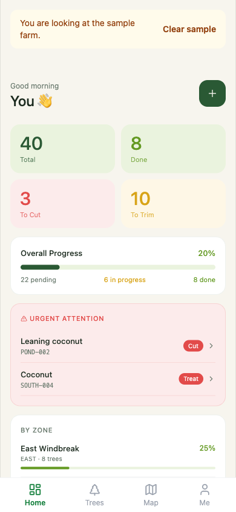
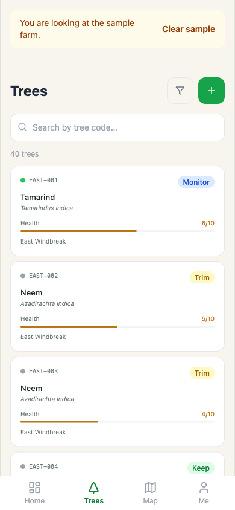
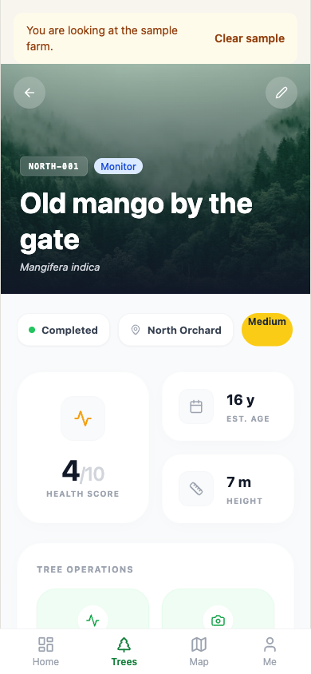
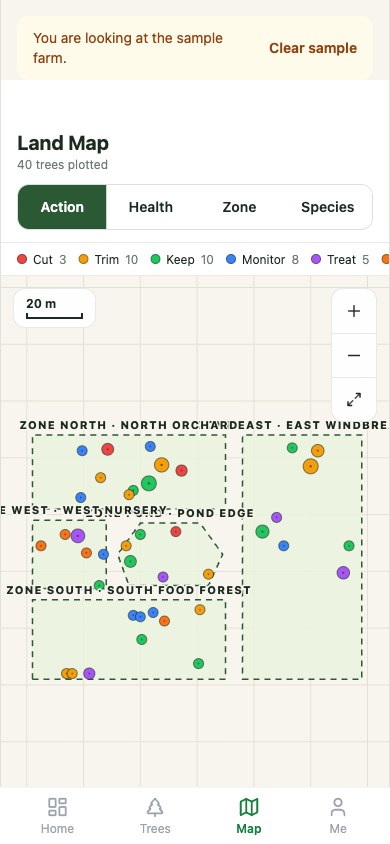

# Arbor

[](./LICENSE)
[](./CONTRIBUTING.md)

Arbor keeps track of every tree on a farm or food forest: where it stands, what it is, how healthy it is and
the work it needs. It runs on a phone, from a link, with no account. The farm stays on the phone, and can be
saved to a file at any time.

**Try it:** open <https://yozo06.github.io/wildarc-arbor/> on a phone and tap **Look around the sample farm**.

<table>
  <tr>
    <td></td>
    <td></td>
    <td></td>
    <td></td>
  </tr>
</table>

The screenshots show "Sample Food Forest", a made-up farm that ships with the app.

## Who it's for

Arbor is for anyone who tends trees on a piece of land and wants a living record of each one —
something you carry into the field, not a spreadsheet you fill in afterwards.

- **Food forests and agroforestry plots** — mixed, many-species plantings where every tree is
  different and worth knowing by name.
- **Smallholdings and market orchards** — keep each tree's age, health and the next job it needs,
  season after season.
- **Community gardens, parks and campus groves** — a shared record that outlives any one volunteer
  and gets handed on intact.
- **Restoration and reforestation projects** — log what went in where, then watch survival, growth
  and the mix of species over the years.

A few things people use it for: taking a tree inventory from scratch; doing the rounds and logging
a health score or a bit of work done, with a photo; finding every tree that needs attention this
week; and seeing how diverse a planting really is. One grower can run the whole thing from a single
phone — the server version adds sign-in so field workers log from their own phones while the owner
keeps the farm.

## Install it on your phone

- **Android (Chrome):** open the link and tap **Install app** (or the ⋮ menu, then **Install app**).
- **iPhone (Safari):** open the link, tap **Share**, then **Add to Home Screen**, and open Arbor from the Home
  Screen. Do this before you add any trees: Safari and the Home Screen app keep separate data.

## Your data

- It stays on the phone, in the browser's storage. There is no account and nothing is sent anywhere.
- **Save my farm** (on the Me page) writes one file, `arbor-farm-<date>.zip`, with every tree, entry and photo.
  Keep it somewhere safe. Arbor reminds you if a week passes without a save.
- **Open a farm file** replaces the farm on the phone with the one in the file. It is also how you move a farm
  to a new phone.
- Clearing the browser's data for the site deletes the farm on that phone. The file is your backup.

## Run it on your computer

The phone version needs nothing but Node 26 (`nvm use` reads `.nvmrc`):

```bash
cd frontend
npm ci
npm run dev
```

Open the address Vite prints. Tests and type checks, also in `frontend/`:

```bash
npx vitest run
npx tsc --noEmit
```

## Server version

The same screens can also run against an Express API and a Supabase database, with sign-in and roles: that is
how Arbor started, and how one farm still uses it. You only need it to work on the API or the database.

> **Run it on your own computer, or for people you trust.** Its sign-in rules are not ready for a public
> address yet: anyone can sign up, and a signed-in person can see other people's contact details. Fixing that
> is the next piece of server work ([docs/STATUS.md](docs/STATUS.md)).

1. **A database.** The whole schema is `supabase/migrations/20261113000000_baseline.sql`, and
   `supabase/seed.sql` fills it with the same made-up sample farm. Either paste both, in that order, into the
   SQL editor of a free Supabase project, or run Supabase on your computer (needs Docker):
   `npx supabase init` (keep the existing files), `npx supabase start`, then `npx supabase db reset`.
2. **Settings.** Copy `.env.example` to `.env` and fill in the database address and service key.
3. **Photos** go to a Google Drive folder through a Google service account (also in `.env`). Without it,
   everything works except uploading photos.
4. **Run it**, in two terminals:

   ```bash
   npm ci
   npm run dev
   ```

   ```bash
   cd frontend
   npm run dev:server
   ```

5. **Make yourself the owner.** The seed creates no accounts, so there is no known password to try. Sign up in
   the app, then run this in the database's SQL editor with your email:

   ```sql
   update public.users set role = 'owner' where email = 'you@example.com';
   ```

The schema and seed are checked by `tests/backend/supabase-baseline.test.ts`, which loads them into an
in-memory Postgres. The Supabase command-line route has not been run by the maintainers yet; tell us if it
trips.

## How it is built

- `frontend/`: React, Vite, Tailwind and Zustand, installable as a web app. The build setting `VITE_DATA_MODE`
  picks where data lives: on the phone (the default) or on the server.
- On the phone, data lives in IndexedDB; the farm file is a zip of `farm.json` and the photos.
- `src/`: the Express and TypeScript API on Supabase, for the server version only.
- Figures with a formula behind them come from separate, MIT-licensed libraries that cite their sources, such
  as [`@wildarc/diversity`](https://github.com/yozo06/wildarc-diversity). The app records and shows; the
  libraries calculate.
- Every push to `main` publishes the phone version to GitHub Pages (`.github/workflows/pages.yml`).

Arbor is part of WildArc, an open-source effort to help farms keep track of their land. It was split out of
[yozo06/tms](https://github.com/yozo06/tms) in November 2026 and keeps that repository's history.

## Contributing

Start with [CONTRIBUTING.md](CONTRIBUTING.md). [docs/STATUS.md](docs/STATUS.md) says where things stand, and the
plans are in [docs/superpowers/specs/](docs/superpowers/specs/).

## Licence

[AGPL-3.0](LICENSE).
