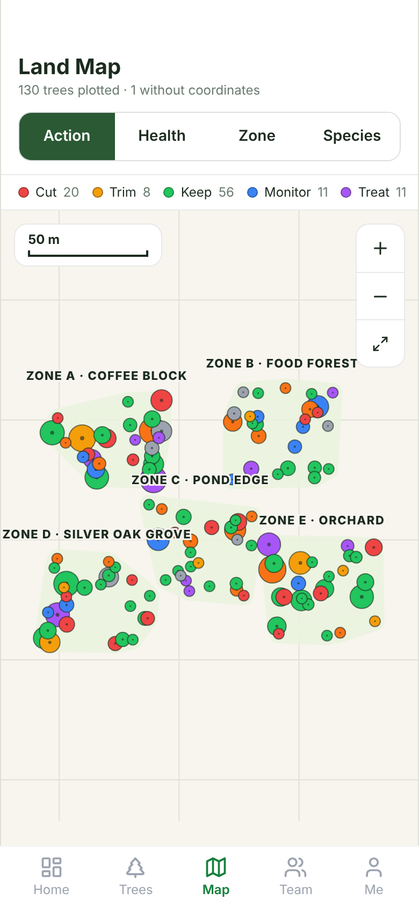
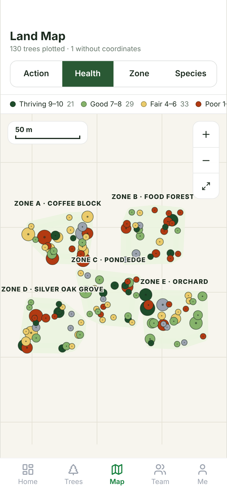
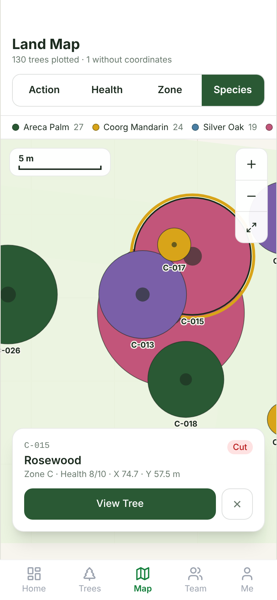

# Arbor Land Map

**Written:** 2026-11-12
**Status:** built and checked against sample data. Not yet run against live farm data.
**Roadmap:** this is the starting point for Stage 1 ("see the farm") of the
[arbor roadmap](../../superpowers/specs/2026-11-12-arbor-roadmap-design.md). The roadmap stays the plan;
this note only describes the map.

## What this is

The Map screen of arbor, rebuilt as a top view of the farm that can be zoomed and panned.

Screens (phone width 390, sample data, rendered from the real build):

| Whole farm, coloured by action | Coloured by health | Zoomed in, tree selected |
|---|---|---|
|  |  |  |

## What the branch holds

Two code commits, then this note:

1. `feat(arbor): zoomable top-view Land Map`: the four map files plus the `brand.*` colour tokens in
   `frontend/tailwind.config.ts`. It needs nothing from the second commit.
2. `fix(frontend): carry over the May revamp edits with module imports`: edits to the routed screens
   (Layout, BottomNav, index.css, TreeCard, TreeList) with their imports pointed at `modules/` and `core/`,
   plus `TreeList.test.tsx` and the removal of the unused `vite-tsconfig-paths` package.

## Files

All under `frontend/src/modules/arbor/`:

| File | Role |
|---|---|
| `components/LandMap.tsx` | The map. SVG, pan and zoom, tree layer, zone shapes, scale bar, zoom buttons. |
| `components/landMap.utils.ts` | Pure helpers: plotting, bounds, fit, legend, zone hull, boundary parsing, scale. |
| `components/landMap.utils.test.ts` | 9 unit tests for the helpers. |
| `pages/MapView.tsx` | The screen: loads data, colour-mode switch, legend, selected-tree card. |

`components/MapCanvas.tsx` (the old fixed-dot canvas) is no longer used by the routed screen. It is left
in place because the legacy `frontend/src/pages/MapView.tsx` still imports it. Delete both together when
the legacy `pages/` folder goes (roadmap Stage 0).

## How it works

- **Coordinates.** World units are metres, straight from `trees.coord_x` and `trees.coord_y`. Y is negated
  for drawing so that north is up. A tree with either coordinate missing is left off the map and counted
  in the header ("1 without coordinates"). A coordinate of 0 is valid.
- **View.** One transform (`translate` + `scale`) on an SVG group. Wheel and two-finger pinch zoom around
  the pointer; one-finger or mouse drag pans; the three buttons zoom in, zoom out and fit the whole farm.
  The map keeps fitting the farm on resize until the user first moves it.
- **Trees.** One circle per tree, radius from `height_m` (0.22 × height, clamped to 1 to 6 m; 1.5 m when
  height is absent), never drawn smaller than 5 px. Larger canopies are drawn first so small trees stay
  on top and tappable. Each circle is a focusable button with a spoken label.
- **Tree codes.** Shown when the typical gap between neighbouring trees is at least 44 px on screen, or
  when there are 12 trees or fewer. The selected tree always shows its code.
- **Colour modes.** Action (always), plus health, zone and species when at least one plotted tree carries
  `health_score`, `zone_code` or `display_name`. The legend lists only the groups present, with counts.
  Action colours come from `core/constants/actionColors.ts`. Zone and species use a 10-colour list; an
  11th group and beyond fall back to grey.
- **Zones.** If `land_zones.boundary_coords` holds at least three points (`[[x, y], …]` or
  `[{x, y}, …]`, also as a JSON string), that outline is drawn. Otherwise the zone is the convex hull of
  its trees with a soft margin. Zone names come from `GET /api/map/zones`; the map works if that call
  fails.
- **Selection.** Tapping a tree opens a card with code, name, zone, health, X and Y, the action badge and
  a "View Tree" button to `/trees/:code`. Tapping empty ground clears it.

## Data it expects

`GET /api/map/trees` (the `map_tree_view` view), one row per tree:

| Field | Needed for | If absent |
|---|---|---|
| `id`, `tree_code`, `action` | everything | required |
| `coord_x`, `coord_y` | placing the tree | tree is not plotted |
| `display_name` | species colouring, card title | no Species mode; card says "Unknown" |
| `zone_code` | zone colouring, zone shapes | no Zone mode, no zone shapes |
| `health_score` | health colouring | no Health mode |
| `height_m` | canopy size | every canopy is 1.5 m |

The view's definition is not in the repository (roadmap section 2.3, item 1), so which of the optional
fields it returns today is unknown. That is the first thing to check against the live database.

## What was checked

In this repository, on the branch, with Node 20 and a clean `npm ci` in `frontend`:

- `npx tsc --noEmit`: no errors.
- `npx vitest run`: 5 files, 39 tests, all pass (9 of them the new map helpers, 18 from
  `TreeList.test.tsx`). The run prints one React warning, "An update to TreeList inside a test was not
  wrapped in act(...)"; it is not a failure and is worth tidying.
- `npm run build`: succeeds.

Before that, where the map was written (Node 22): the built app was opened at phone width with 131 sample
trees in 5 zones served in place of the API. Fit, the four colour modes, zoom buttons, drag, tap to select
and the card all behaved, with no console errors.

Not checked: the live API and real tree data, a real phone (pinch was not exercised, only wheel, buttons
and drag), more than about 130 trees.

## Known gaps

1. **Not run on real data.** See "Data it expects".
2. **Zone labels can collide** with each other and with trees at the whole-farm zoom when zones sit close
   together, and a label can run off the left edge.
3. **Canopy size is a rule of thumb.** It over-draws palms and tall slender trees. A per-species canopy
   width would fix it.
4. **One SVG node per tree.** Fine in the low thousands; beyond that it needs culling or a canvas layer.
   The API also stops at 1000 rows today (roadmap section 2.3, item 10).
5. **No way to draw a zone boundary.** `boundary_coords` is read but nothing writes it from the app.
6. **No "log health" action on the card.** The card only links to the tree page.

## Differences from the design

The roadmap (section 2.2) describes the Land Map as having "zone jumps" and a "tree drawer". Those were
designed but are not in the code:

- **Zone jump chips:** designed, not built.
- **Drawer with size and age:** the built card is smaller (code, name, zone, health, X/Y, action).
- **Pond, worker house, path, gate, understory plants:** in the design as illustration only. The database
  has nothing for them, so they were left out of the build.
- **Zone colouring:** built, not in the design.

Roadmap Stage 1 asks for a drawer with health, action and size and a button to log health. That is new
work on top of this branch, not part of it.
